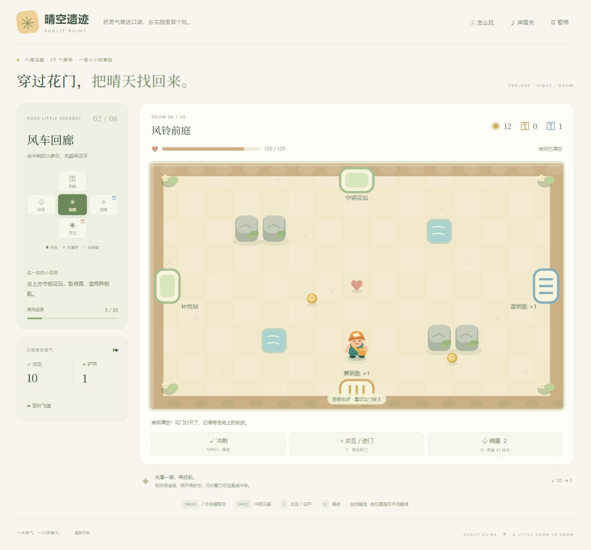
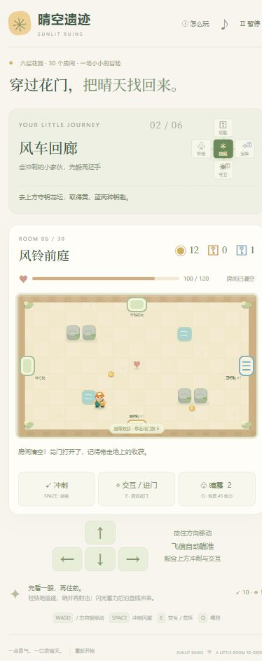

# 晴空遗迹 · Sunlit Ruins

一款明亮的花园房间动作冒险。移动与冲刺躲避，飞信自动瞄准射击；清空房间后收集钥匙、金币和晶石，在补给站安排成长，再挑战守卫，抵达花塔终点。

[在线试玩](https://reoxy258.github.io/parcel-path/) · [测试记录](docs/QA-v3.md) · [随机与难度记录](docs/QA-v4.md) · [本轮打磨记录](docs/QA-v5.md) · [素材来源](docs/ASSETS.md)



## 玩法

6 层花园，每层 5 个房间，共 30 个房间。每层固定采用前庭、守钥房、补给站、可选宝库、层末守卫的结构（地图方位固定、易学）；房间内部的地形排布、敌群组合、出生位置与宝库晶石类型则由「旅程印记」（种子）随机生成——同一印记的旅程完全一致，新旅程自动掷出新的印记。通关需要击败六层守卫并进入最终花环，宝库和补给站可以按资源状况选择。

- **房间战斗**：追逐飞虫、蓄力跳跃怪、冲锋蜘蛛、三连种子蘑菇，以及交替释放扇形与环形弹幕的守卫。清房后门开启。战斗房敌人数量从每间 3 只逐步增至 6 只，守卫房随深度编入最多 4 名随从，全程约 100 位小怪。
- **障碍**：几何图形绘制的灰石（六面多面体）阻挡角色与子弹，木箱（立方体）可击碎并掉落金币，水池（圆形涟漪池塘）阻挡行走，金色荆棘（三角警示阵）周期升起。
- **资源路线**：上方守钥房掉落黄色、蓝色钥匙。黄钥匙开南侧守卫门；蓝钥匙开东侧可选宝库。门首次打开消耗一枚钥匙，往返不重复消耗。
- **补给站**：货架直接摆在房间里——走近按 E 购买攻击、护甲、体力上限和药水（页面下方清单同样可点），价格与售罄状态实时可见；宝库晶石提供额外属性。每层守卫后可从三项随行强化中选一项，包括多重飞信、穿透、射速、移动速度、护甲和清房治疗。
- **难度曲线**：护甲采用收益递减的减伤公式（伤害 = 数值 × 40 / (护甲 × 4 + 40)，保底 1 点），叠甲无法把伤害压穿；敌人生命与攻击随层数约 1.2–1.9 倍增长。
- **温和失败**：倒下可在本层前庭满血复活，已完成房间、钥匙和强化保留，金币减少 20%。

| 操作 | 方式 |
| --- | --- |
| 移动 | WASD / 方向键；手机按住屏幕方向按钮 |
| 射击 | 自动瞄准最近可见敌人；按住画面可手动瞄准 |
| 冲刺 | 空格 / 冲刺按钮，短暂无敌，有冷却 |
| 开门、进入花环、货架购买 | 靠近目标按 E / 交互按钮；也可持续走向已开启的门 |
| 使用药水 | Q / 晴露按钮，恢复 45 体力 |
| 暂停 | P / Esc / 暂停按钮；窗口失焦时自动暂停 |

浏览器本地保存房间、清房、拾取、购买和强化进度。战斗中刷新会回到当前房间入口，未清空房间的敌人重新出现。存储不可用时仍能继续本次会话。新版使用独立的 v3 存档；旧版解谜进度保留。

## 本地运行

需要 Node.js 22 或更新版本，不需要安装依赖。

```sh
npm run dev
npm test
npm run build
```

打开 `http://127.0.0.1:4173`。ES Modules 需要 HTTP 服务，不能直接双击页面运行。构建后的 `dist/` 可以部署到静态 HTTPS 托管；相对资源路径支持 GitHub Pages 仓库子路径。

`main` 更新后，GitHub Actions 自动测试、构建并发布到现有 Pages 地址。

## 结构

| 文件 | 内容 |
| --- | --- |
| `index.html` / `src/adventure.css` | 响应式游戏界面 |
| `src/adventure-ui.js` | 输入、音效、弹窗、状态展示与存档协调 |
| `src/adventure.js` | 战斗、碰撞、钥匙、掉落、成长、死亡和存档 |
| `src/world.js` | 种子化地牢生成：30 房间的地形、敌群、出生点与晶石（mulberry32） |
| `src/scene.js` | Canvas 花园与动画绘制（手绘小旅行家主角、几何障碍、补给站货架） |
| `assets/sprites/` | 用户提供的四张原始怪物图集 |
| `tests/adventure.test.js` | 新版规则与全流程验证 |
| `tests/dungeon.test.js` | 随机生成确定性与难度曲线验证 |
| `puzzle.html` / `src/app.js` | 保留的旧版机关解谜入口与实现 |

游戏运行时不需要账号、后端、外部字体或远程图片。音效使用 Web Audio 合成，默认关闭。怪物素材来源和使用帧范围见 [素材说明](docs/ASSETS.md)。

<details><summary>手机预览</summary>



</details>
