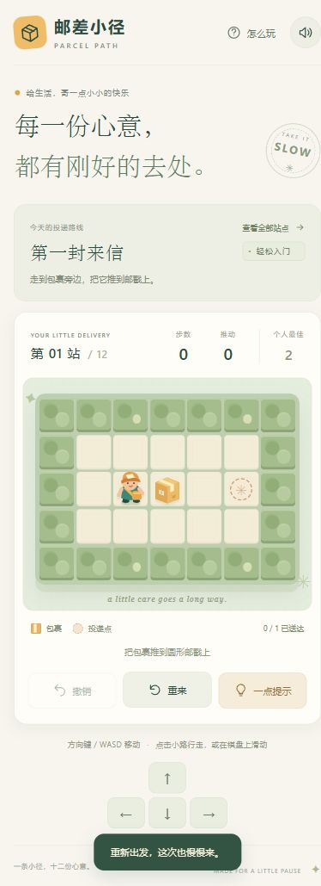

# 邮差小径 · Parcel Path

把每一份心意，送到刚好的地方。

一款以经典推箱规则为基础、采用原创邮差主题与 SVG 插画的 H5 休闲解谜游戏。单屏关卡，无倒计时，无账号、广告和远程服务依赖。


## 开始游玩

需要 Node.js 22 或更新版本，无需安装 npm 依赖。

```sh
npm run dev
```

打开终端显示的 `http://127.0.0.1:4173`。源码使用 ES Modules，请通过 HTTP 服务访问，不要直接双击 HTML 文件。

## 玩法

将所有包裹推到圆形邮戳上即可通关。只能推，不能拉，不能同时推两个包裹。

| 操作 | 方式 |
| --- | --- |
| 移动 | 方向键、WASD、屏幕方向按钮，或在棋盘上滑动 |
| 点击行走 | 点击可到达的空地，邮差沿最短可行路径行走；不会自动推箱 |
| 撤销 | Z / U，或点击“撤销” |
| 重开本关 | R，或点击“重来” |
| 下一步提示 | H，或点击“一点提示” |
| 选关 | “查看全部站点”，逐关解锁，也可重访已完成关卡 |

按最短步数完成获得三星；多走不超过 6 步获得两星；其余通关获得一星。提示不代替玩家移动。关卡进度、个人最佳与音效设置保存在当前浏览器的本地存储中。

## 内容与实现

- 12 个手工设计并经求解器验证的关卡，分为晨光花园、雨后街角、黄昏小巷三个区域。
- 点击、键盘与指针滑动输入；适配手机和桌面。
- 完整撤销、重开、连续解锁、星级、个人最佳和音效开关。
- 提示在 Web Worker 中进行广度优先搜索，给出当前局面的最短步数解；不可解时建议撤销或重开。
- Worker 不可用时降级为本地计算；存档不可用时仍可在当前会话游玩。
- 尊重系统减少动画设置；提供键盘焦点、按钮名称、状态播报与棋盘坐标标签。
- 图片均为项目内的 SVG 或截图，运行时不请求外部字体、图片、统计或 API。

## 测试与构建

```sh
npm test
npm run build
```

构建结果位于 `dist/`，可直接放在任意静态 HTTPS 托管服务上。资源路径均为相对路径，支持仓库子路径部署。

已配置 GitHub Actions：提交或 PR 自动运行测试和静态构建。

## 发布在线试玩

已提供 `.github/workflows/pages.yml`，在公有仓库中将 `dist/` 发布到 GitHub Pages。首次启用步骤：

1. 在仓库 Settings → General → Danger Zone → Change repository visibility 中将仓库设为 Public。源码和提交历史将对所有人可见。
2. 在 Settings → Pages → Build and deployment → Source 中选择 GitHub Actions。
3. 在 Actions 中选择 **Publish game to GitHub Pages**，点击 **Run workflow**，选择 `main` 并运行。

部署成功后，在线试玩地址为 https://reoxy258.github.io/parcel-path/ 。这个地址在首次部署成功前不可用。

之后推送到 `main` 会先验证所有关卡、构建，再自动更新网站。私有仓库中的发布任务会跳过。

可参考 [GitHub Pages 官方文档](https://docs.github.com/en/pages/getting-started-with-github-pages/using-custom-workflows-with-github-pages)。

## 项目结构

```text
index.html                游戏页面与 SVG 图形
src/app.js                输入、动画、弹窗与 UI 状态协调
src/engine.js             纯函数规则、路径搜索、最短解求解器
src/levels.js             12 个关卡与最短步数
src/storage.js            容错存档与解锁规则
src/solver.worker.js      后台求解入口
src/styles.css            响应式样式与减少动画支持
scripts/serve.mjs          本地开发服务
scripts/build.mjs          静态打包
tests/engine.test.js       游戏规则、关卡、存档测试
docs/QA.md                审查分工、修复记录与验证范围
```

查看 [测试与审查记录](docs/QA.md)。

<details>
<summary>手机预览</summary>



</details>
